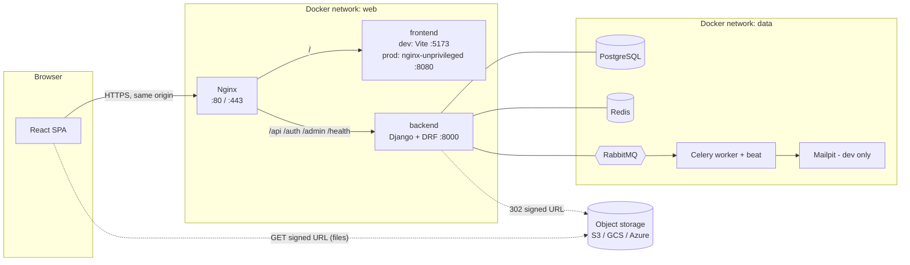
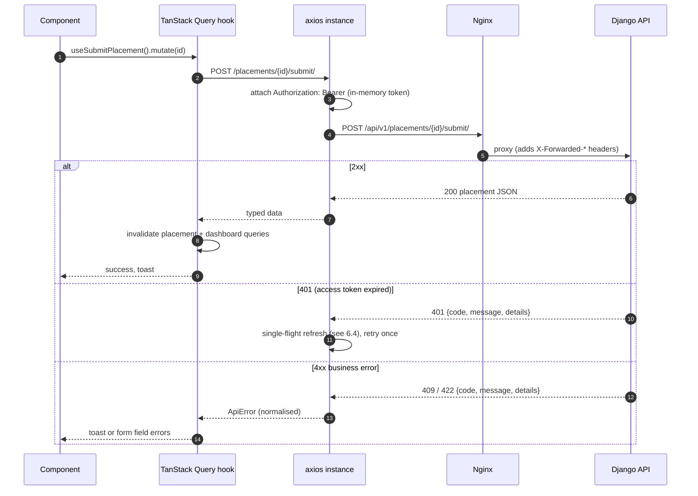
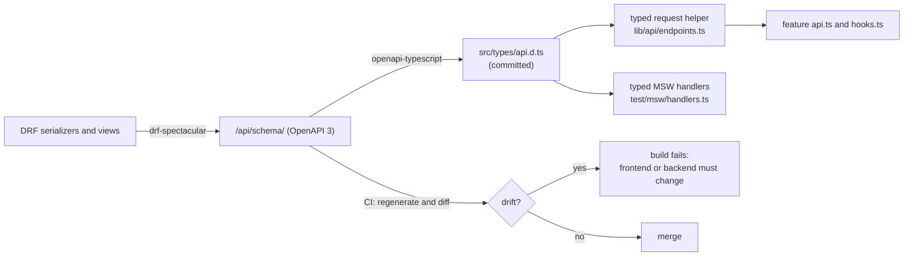
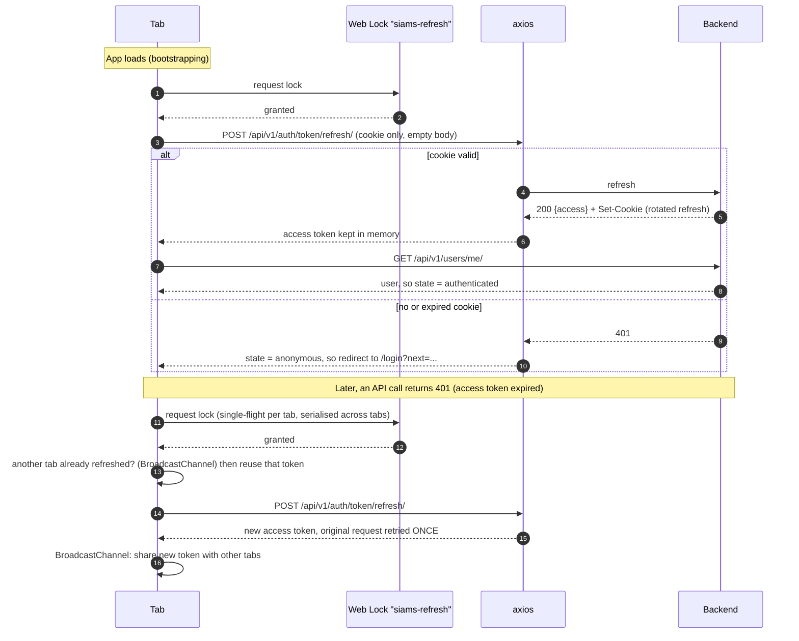
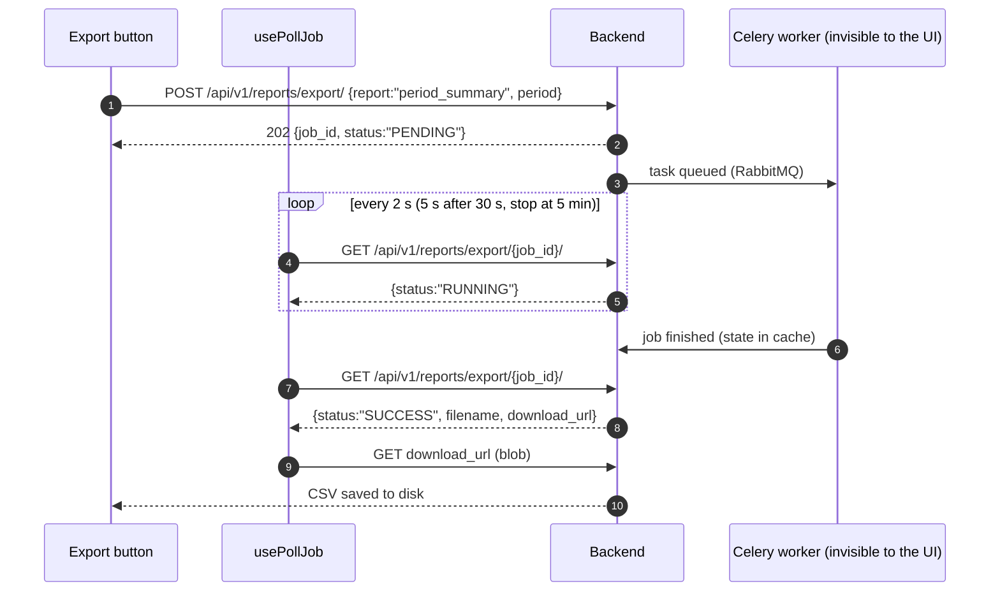

# SIAMS Frontend: Architecture and Integration Design
### React web app for the Student Internship & Attachment Management System

> Scope: **structure, integration, API strategy, security, Docker and testing**. Not screen layouts: the UI is assembled from **shadcn/ui** components, so the work here is deciding *what* gets built, *where it lives*, and *how it talks to the backend without calling the wrong thing*.
> Companion documents: `docs/internship-system-design.md` (system), `docs/CONTRACTS.md` (team contracts). The backend (Django + DRF, Nginx, PostgreSQL, Redis, RabbitMQ, Celery) is already designed and built; this document only consumes its contract.

---

## 0. Decisions at a Glance

| Area | Decision | Why |
|---|---|---|
| Build tool | **Vite** + **React 19** + **TypeScript (strict)** | Fast HMR, tiny config, static build output that any web server or CDN can host |
| Rendering | **SPA** (client-side). The landing page is a static, code-split route with **zero API calls** | The app sits behind login; SEO matters only for the landing page |
| Routing | **React Router v7** (data router, library mode) | Route-level loaders/guards, lazy routes, URL as state |
| Server state | **TanStack Query v5** | Caching, deduplication, retries, invalidation; no hand-rolled fetch state |
| HTTP client | **axios**, **one instance**, inside `src/lib/api` only | Interceptors for auth refresh and error normalisation |
| API contract | **Types generated from the backend's OpenAPI schema** (`openapi-typescript`) | Calling a wrong path, method or field becomes a **compile error**; CI fails on schema drift |
| Forms | **React Hook Form + Zod** | Same validation rules as the backend, field-level errors mapped from the API envelope |
| UI | **shadcn/ui** (Radix) + **Tailwind CSS v4** | Accessible primitives, copy-in components we own, no runtime UI library |
| Look | Black and white, **Inter** (variable, self-hosted), **14 px** application body | Professional, dense-data friendly, no external font requests |
| Auth | Access token **in memory only**; refresh token in the backend's **HttpOnly, SameSite=Strict** cookie; Web Locks to serialise refresh across tabs | No token in `localStorage` (XSS), works with rotating and blacklisted refresh tokens |
| Topology | **Same origin**: Nginx serves `/` (frontend) and `/api` (backend) on one host | No CORS, strict cookies, identical in dev, Docker and production |
| Container | Dev: Vite in a Node container. Prod: static files in **nginx-unprivileged**, fronted by the main Nginx | Dev/prod parity, independently deployable and rollback-able |
| Networks | `web` (nginx, frontend, backend) and `data` (backend, workers, db, redis, rabbitmq). **The frontend can never reach `data`** | Least privilege enforced by Docker, not by convention |
| Async work | `202 Accepted` + **polling** (CSV import/export). The browser never talks to RabbitMQ | Matches the backend contract; no extra moving parts |
| Tests | **Vitest** + Testing Library + **MSW**, **Playwright** (against the real Docker stack), **axe** accessibility, **schema-drift check** | Unit, integration, contract and end-to-end coverage that also runs in Docker on any OS |

---

## 1. Principles

1. **The backend is the authority.** The frontend improves usability (hiding buttons, validating early). Every rule is enforced again by the API. Never rely on the UI for security.
2. **Contract first.** The OpenAPI schema produced by `drf-spectacular` is the single source of truth for paths, methods, request bodies and responses.
3. **One way to do each thing.** One HTTP client, one query-key factory, one error type, one table component, one confirm dialog. Duplicated UI is a bug.
4. **Feature folders over type folders.** Everything for "placements" lives together; features talk to each other only through public exports.
5. **Same artifact everywhere.** The production image is built once; environment differences are runtime configuration, not rebuilds.
6. **Works on any machine.** Everything runs in Docker, with file watching that works on Linux, macOS and Windows.
7. **Accessible by default.** Radix primitives, keyboard support, and status never conveyed by colour alone (essential in a black-and-white design).

---

## 2. How the Frontend Integrates with the Rest of the System

### 2.1 Topology



### 2.2 What the frontend talks to, and what it must never touch

| Service | Frontend relationship | How |
|---|---|---|
| **Nginx** | The only entry point. Terminates TLS, rate-limits login, serves static assets, proxies `/api`. | Browser to Nginx over one origin |
| **Backend (Django/DRF)** | Sole data source and rule authority | JSON over `/api/v1/...`; multipart for the two upload endpoints |
| **PostgreSQL** | **Never.** All data arrives through the API. The client cache (TanStack Query) is in-memory only and cleared on logout. | n/a |
| **Redis** | **Never.** (Backend uses it for cache, throttling, job state.) The frontend only sees effects: `429 Too Many Requests`, job status endpoints. | n/a |
| **RabbitMQ / Celery** | **Never directly.** Async work is exposed as *jobs*: `POST` returns `202` with a `job_id`; the UI polls a status endpoint. | Polling with TanStack Query `refetchInterval` |
| **Email (Mailpit/SMTP)** | Indirect. Emails link back to the frontend: `FRONTEND_URL/reset-password/<uid>/<token>/`. The app must provide that route. | Route `/reset-password/:uid/:token` |
| **Object storage** | Indirect. Files are private. The API replies `302` to a short-lived signed URL (cloud) or streams the file (filesystem). | Authenticated `GET` as a blob, see 6.8 |
| **Sentry (optional)** | Error reporting, configured at runtime | `config.json` DSN |

### 2.3 Request lifecycle (every API call)



---

## 3. Docker, Networks and Environments

### 3.1 Environments

| | Development (Docker) | Production |
|---|---|---|
| Frontend process | `vite` dev server on `:5173` (HMR) | Static files served by **nginx-unprivileged** on `:8080` |
| Entry point | Nginx `:80` proxies `/` to `frontend:5173` and `/api` to `backend:8000` | Same Nginx (TLS) proxies `/` to `frontend:8080` and `/api` to `backend:8000` |
| API base URL | `/api/v1` (relative) | `/api/v1` (relative) |
| Config | `.env` for the stack; `public/config.json` defaults | Environment variables rendered into `/config.json` at container start |
| Source | Bind mount `./frontend:/app` | Baked into the image |
| Started with | `make up-frontend` | `docker compose -f docker-compose.yml -f docker-compose.prod.yml up -d` |

Because the API base URL is **relative**, no build-time environment variable decides where the backend is. The same image works on localhost, staging and production.

### 3.2 Networks (least privilege)

Two user-defined networks replace the default network:

| Network | Members | Purpose |
|---|---|---|
| `web` | `nginx`, `frontend`, `backend` | HTTP traffic that originates from the browser |
| `data` | `backend`, `worker`, `beat`, `db`, `redis`, `rabbitmq`, `mailpit`, `minio` | Backing services. In production it is `internal: true` (no route to the internet); `backend`, `worker` and `beat` also join an `egress` network for email and object storage |

Rules this gives us, enforced by Docker:

- `frontend` is **only** on `web`. It cannot resolve `db`, `redis` or `rabbitmq`, so even a compromised frontend container cannot reach them.
- `nginx` is the only service that publishes host ports.
- `backend` bridges both networks: it receives requests on `web` and talks to data services on `data`.

### 3.3 Compose changes (replaces the `frontend` service and adds networks)

```yaml
# docker-compose.yml (additions and replacements)

networks:
  web: {}
  data: {}              # production override makes this internal: true

services:
  db:        { networks: [data] }
  redis:     { networks: [data] }
  rabbitmq:  { networks: [data] }
  mailpit:   { networks: [data] }
  minio:     { networks: [data] }
  backend:   { networks: [web, data] }
  worker:    { networks: [data] }
  beat:      { networks: [data] }
  nginx:     { networks: [web] }

  frontend:
    profiles: ["frontend"]
    build:
      context: ./frontend
      target: dev
    networks: [web]
    environment:
      CHOKIDAR_USEPOLLING: ${FRONTEND_USE_POLLING:-false}   # true on Windows/macOS bind mounts
      VITE_HMR_CLIENT_PORT: "80"
    volumes:
      - ./frontend:/app
      - frontend_node_modules:/app/node_modules             # named volume: node_modules stays Linux-native
    command: npm run dev -- --host 0.0.0.0 --port 5173
    healthcheck:
      test: ["CMD", "wget", "-qO-", "http://localhost:5173/"]
      interval: 10s
      timeout: 5s
      retries: 12
    expose: ["5173"]

  e2e:                                                      # Playwright against the real stack (make fe-e2e)
    profiles: ["e2e"]
    image: mcr.microsoft.com/playwright:v1.50.0-noble       # pin to the @playwright/test version in package.json
    working_dir: /work
    networks: [web]
    volumes:
      - ./frontend:/work
    environment:
      E2E_BASE_URL: http://nginx
    depends_on:
      nginx: { condition: service_started }

volumes:
  frontend_node_modules:
```

```yaml
# docker-compose.prod.yml (additions)

networks:
  data:
    internal: true            # databases and brokers have no internet route
  egress: {}                  # backend/worker/beat only: SMTP, object storage

services:
  backend: { networks: [web, data, egress] }
  worker:  { networks: [data, egress] }
  beat:    { networks: [data] }

  frontend:
    profiles: !reset []                                      # always on in production
    image: ${FRONTEND_IMAGE:-siams-frontend}:${IMAGE_TAG:-latest}
    build:
      context: ./frontend
      target: prod
    restart: unless-stopped
    volumes: !reset []
    command: !reset null
    environment:
      APP_NAME: SIAMS
      SENTRY_DSN: ${FRONTEND_SENTRY_DSN:-}
      ASSET_ORIGIN: ${FRONTEND_ASSET_ORIGIN:-}               # object-storage origin, for CSP connect-src
    healthcheck:
      test: ["CMD", "wget", "-qO-", "http://localhost:8080/healthz"]
      interval: 15s
      timeout: 3s
      retries: 5

  nginx:
    depends_on:
      frontend: { condition: service_healthy }
      backend:  { condition: service_healthy }
```

### 3.4 Required edits to the existing Nginx files (Team Alpha owns `infra/`)

| File | Change | Reason |
|---|---|---|
| `infra/nginx/nginx.prod.conf` | Replace `location / { root ...; try_files ...; }` with `location / { proxy_pass http://frontend:8080; include /etc/nginx/proxy_params; }` and add `upstream frontend { server frontend:8080; }`. Remove the `frontend_dist` volume from `docker-compose.prod.yml`. | Same shape as development (proxy to the frontend service); the frontend image owns its caching and security headers |
| `infra/nginx/nginx.dev.conf` | No change. It already proxies `/` to `frontend:5173` with `Upgrade` headers (HMR) and returns a friendly 503 when the frontend is not running. | n/a |
| `Makefile` | Add the `fe-*` targets in section 14. | One command vocabulary |

> Alternative considered: Nginx serving the build from a shared volume (the milestone 0 layout). Rejected because the volume couples release order, can serve stale files after a rollback, and cannot be deployed to a CDN or another host independently.

### 3.5 `frontend/Dockerfile` (multi-stage)

```dockerfile
ARG NODE_VERSION=22

# ---------- deps: install once, cached by the lockfile ----------
FROM node:${NODE_VERSION}-bookworm-slim AS deps
WORKDIR /app
COPY package.json package-lock.json ./
RUN npm ci

# ---------- dev: used by docker compose (source is bind-mounted over /app) ----------
FROM deps AS dev
ENV NODE_ENV=development
COPY . .
EXPOSE 5173
CMD ["npm", "run", "dev", "--", "--host", "0.0.0.0", "--port", "5173"]

# ---------- build: static assets ----------
FROM deps AS build
COPY . .
RUN npm run build                      # runs typecheck first (see package.json "build")

# ---------- prod: tiny, non-root, static ----------
FROM nginxinc/nginx-unprivileged:stable-alpine AS prod
COPY --from=build /app/dist /usr/share/nginx/html
COPY nginx/default.conf.template /etc/nginx/templates/default.conf.template
COPY nginx/config.json.template /etc/nginx/templates-app/config.json.template
COPY nginx/40-render-config.sh /docker-entrypoint.d/40-render-config.sh
EXPOSE 8080
HEALTHCHECK --interval=30s --timeout=3s CMD wget -qO- http://localhost:8080/healthz || exit 1
```

Why `bookworm-slim` and not `alpine` for dev/build: Vite, esbuild, Rollup and Playwright ship glibc native binaries; musl (Alpine) causes avoidable failures on Apple Silicon and some Linux hosts. Only the final, static-serving stage uses Alpine.

### 3.6 `frontend/nginx/default.conf.template` (production static server)

```nginx
server {
    listen 8080;
    server_name _;
    root /usr/share/nginx/html;
    index index.html;

    gzip on;
    gzip_types text/css application/javascript application/json image/svg+xml;

    # add_header in a location REPLACES inherited headers, so the shared set is included in each one.
    # security-headers.inc holds: X-Content-Type-Options, Referrer-Policy, X-Frame-Options, CSP, Permissions-Policy.

    location = /healthz { access_log off; add_header Content-Type text/plain; return 200 "ok\n"; }

    location /assets/ {                       # hashed file names: cache forever
        expires 1y;
        add_header Cache-Control "public, immutable";
        include /etc/nginx/conf.d/security-headers.inc;
    }

    location = /config.json {                 # runtime configuration: never cached
        add_header Cache-Control "no-store";
        include /etc/nginx/conf.d/security-headers.inc;
    }

    location / {                              # SPA fallback; index.html must always be revalidated
        add_header Cache-Control "no-cache";
        include /etc/nginx/conf.d/security-headers.inc;
        try_files $uri /index.html;
    }
}
```

`security-headers.inc` content (CSP is the important one; `${ASSET_ORIGIN}` is the object-storage origin and is empty for filesystem storage):

```nginx
add_header X-Content-Type-Options "nosniff" always;
add_header X-Frame-Options "DENY" always;
add_header Referrer-Policy "strict-origin-when-cross-origin" always;
add_header Permissions-Policy "camera=(), microphone=(), geolocation=()" always;
add_header Content-Security-Policy "default-src 'self'; script-src 'self'; style-src 'self'; style-src-attr 'unsafe-inline'; img-src 'self' data: blob: ${ASSET_ORIGIN}; font-src 'self'; connect-src 'self' ${ASSET_ORIGIN}; frame-ancestors 'none'; base-uri 'self'; form-action 'self'" always;
```

`style-src-attr 'unsafe-inline'` is needed because Radix positions popovers with inline style attributes; scripts stay strictly `'self'`.

`40-render-config.sh` renders `/usr/share/nginx/html/config.json` from the environment at container start (so one image serves every environment):

```sh
#!/bin/sh
set -eu
envsubst '${APP_NAME} ${SENTRY_DSN}' \
  < /etc/nginx/templates-app/config.json.template \
  > /usr/share/nginx/html/config.json
```

```json
{ "appName": "${APP_NAME}", "sentryDsn": "${SENTRY_DSN}" }
```

### 3.7 Running identically on any OS

| Problem | Mitigation |
|---|---|
| Bind-mounted files do not emit change events on Windows/macOS | `FRONTEND_USE_POLLING=true` turns on polling (`server.watch.usePolling` in `vite.config.ts`). Default `false` on Linux. |
| `node_modules` built for the host OS leaks into the container | `node_modules` is a **named volume** (`frontend_node_modules`); never mounted from the host |
| Line endings (CRLF) break shell scripts and Prettier checks | `.gitattributes`: `* text=auto eol=lf`; `.editorconfig` already sets `lf` |
| Vite rejects `Host: nginx` or `Host: frontend` (host allow-list) | `server.allowedHosts: true` in development only |
| HMR websocket connects to the wrong port behind Nginx | `server.hmr.clientPort` read from `VITE_HMR_CLIENT_PORT` (80 behind Nginx) |
| Apple Silicon / ARM | Official multi-arch images only (`node`, `nginx-unprivileged`, `playwright`); no architecture-specific native dependencies |
| Dependencies change but the container still has old ones | `make fe-install` runs `npm ci` inside the container and refreshes the named volume |
| Different Node versions between developers | `.nvmrc` (22) and `engines` in `package.json`; Docker is the reference |

---

## 4. Tech Stack and Quick Setup

### 4.1 Libraries and why each one earns its place

| Concern | Library | Notes |
|---|---|---|
| Framework | `react`, `react-dom` (19) | |
| Language | `typescript` (strict) | `noUncheckedIndexedAccess` on |
| Bundler | `vite`, `@vitejs/plugin-react` | |
| Routing | `react-router-dom` (v7, data router) | Lazy routes, loaders for guards |
| Server state | `@tanstack/react-query` (+ devtools in dev) | |
| Tables | `@tanstack/react-table` | The engine under the shadcn data table pattern |
| HTTP | `axios` | One instance in `src/lib/api/client.ts` |
| API types | `openapi-typescript` | Generates `src/types/api.d.ts` from `/api/schema/` |
| Forms | `react-hook-form`, `zod`, `@hookform/resolvers` | |
| Styling | `tailwindcss` v4 + `@tailwindcss/vite`, `tailwind-merge`, `clsx`, `class-variance-authority` | The last three arrive with shadcn |
| UI primitives | **shadcn/ui** (Radix UI), `lucide-react` icons, `sonner` toasts, `cmdk` | All via the shadcn CLI |
| File upload UX | `react-dropzone` | Drag and drop, type and size checks before upload |
| Dates | `date-fns` | Date-only API values are parsed as local dates, see 6.10 |
| Font | `@fontsource-variable/inter` | Self-hosted, no third-party request |
| Unit/component tests | `vitest`, `@vitest/coverage-v8`, `jsdom`, `@testing-library/react`, `@testing-library/user-event`, `@testing-library/jest-dom`, `vitest-axe` | |
| API mocking | `msw` | Handlers typed from the generated API types |
| End-to-end | `@playwright/test`, `@axe-core/playwright` | Runs against the real Docker stack |
| Quality | `eslint` (+ `typescript-eslint`, `eslint-plugin-react-hooks`, `eslint-plugin-jsx-a11y`, `eslint-plugin-boundaries`), `prettier` (+ `prettier-plugin-tailwindcss`), `husky`, `lint-staged`, `knip`, `size-limit` | `boundaries` enforces the feature-folder rules; `knip` finds dead code |
| Optional | `@sentry/react` | Only when a DSN is configured at runtime |

Deliberately **not** used: Redux/Zustand (server state is in TanStack Query, the rest is local or URL state), a CSS-in-JS runtime, a second HTTP client, Moment.js, `localStorage` for tokens.

### 4.2 Setup commands (from the repository root)

```bash
# 1. Create the app inside the existing frontend/ folder
cd frontend
npm create vite@latest . -- --template react-ts      # choose "Ignore files and continue" for the existing README
npm install

# 2. Tailwind CSS v4
npm install tailwindcss @tailwindcss/vite
npm install -D @types/node

# 3. Path alias "@/..." : add to BOTH tsconfig.json and tsconfig.app.json
#    "compilerOptions": { "baseUrl": ".", "paths": { "@/*": ["./src/*"] } }
#    and to vite.config.ts (see 4.3)

# 4. shadcn/ui  (answers: style "New York", base colour "Neutral", CSS variables "yes")
npx shadcn@latest init

# 5. Every shadcn component this application needs (inventory and usage map in section 10)
npx shadcn@latest add accordion alert alert-dialog avatar badge breadcrumb button calendar card \
  checkbox collapsible command dialog dropdown-menu form input label navigation-menu pagination \
  popover progress radio-group scroll-area select separator sheet sidebar skeleton sonner switch \
  table tabs textarea tooltip

# 6. Runtime libraries
npm install axios @tanstack/react-query @tanstack/react-table react-router-dom \
  react-hook-form zod @hookform/resolvers date-fns react-dropzone @fontsource-variable/inter

# 7. Development libraries
npm install -D @tanstack/react-query-devtools openapi-typescript \
  vitest @vitest/coverage-v8 jsdom @testing-library/react @testing-library/user-event \
  @testing-library/jest-dom vitest-axe msw \
  @playwright/test @axe-core/playwright \
  eslint-plugin-jsx-a11y eslint-plugin-boundaries prettier prettier-plugin-tailwindcss \
  husky lint-staged knip size-limit @size-limit/file

# 8. Generate API types from the running backend (stack must be up: make up)
npm run api:types

# 9. Run it
cd .. && make up-frontend          # http://localhost  (Nginx -> Vite, API on the same origin)
```

If the CLI reports the shadcn `form` component as superseded by `field`, take the replacement: the React Hook Form + Zod approach in section 9 does not change.

### 4.3 Key configuration files

`package.json` scripts:

```json
{
  "scripts": {
    "dev": "vite",
    "build": "tsc -b && vite build",
    "preview": "vite preview",
    "typecheck": "tsc -b --noEmit",
    "lint": "eslint . && prettier --check .",
    "format": "prettier --write .",
    "test": "vitest run",
    "test:watch": "vitest",
    "test:cov": "vitest run --coverage",
    "test:e2e": "playwright test",
    "api:types": "openapi-typescript ${OPENAPI_URL:-http://localhost/api/schema/} -o src/types/api.d.ts",
    "api:check": "npm run api:types && git diff --exit-code src/types/api.d.ts",
    "size": "size-limit",
    "knip": "knip"
  },
  "engines": { "node": ">=22" }
}
```

`vite.config.ts` (behaviour that matters; not the whole file):

```ts
export default defineConfig({
  plugins: [react(), tailwindcss()],
  resolve: { alias: { '@': path.resolve(__dirname, 'src') } },
  server: {
    host: true,
    port: 5173,
    allowedHosts: true,                                   // dev only: Host may be "nginx" or "frontend"
    watch: { usePolling: process.env.CHOKIDAR_USEPOLLING === 'true' },
    hmr: { clientPort: Number(process.env.VITE_HMR_CLIENT_PORT ?? 80) },
    proxy: {                                              // only used when Vite is opened directly on :5173
      '/api': { target: process.env.API_PROXY_TARGET ?? 'http://backend:8000', changeOrigin: false },
    },
  },
  build: { sourcemap: 'hidden', target: 'es2022' },       // maps are generated but not referenced by the bundles
  test: {
    environment: 'jsdom',
    setupFiles: ['./src/test/setup.ts'],
    css: false,
    coverage: { provider: 'v8', thresholds: { lines: 80, functions: 80, branches: 70 } },
  },
});
```

`.size-limit.json`: initial JavaScript for an authenticated page under **200 kB gzip**; the landing route under **90 kB gzip**.

ESLint rules that protect the architecture (see 6.11): `no-restricted-imports` for `axios` outside `src/lib/api`; `boundaries/element-types` so a feature may import `components/*`, `lib/*`, `config/*` and other features only through their `index.ts`; `jsx-a11y/recommended`; `react-hooks/exhaustive-deps` as error.

---

## 5. Project Structure (everything inside `frontend/`)

```text
frontend/
├── Dockerfile                          # dev | build | prod targets (3.5)
├── .dockerignore                       # node_modules, dist, coverage, playwright-report, .env*
├── .nvmrc                              # 22
├── .gitattributes                      # * text=auto eol=lf
├── .prettierrc  .prettierignore
├── eslint.config.js                    # flat config, boundaries + a11y + restricted imports
├── components.json                     # shadcn config (aliases, style, css file)
├── knip.json  .size-limit.json
├── index.html                          # <div id="root">, no inline scripts (CSP)
├── package.json  package-lock.json
├── tsconfig.json  tsconfig.app.json  tsconfig.node.json
├── vite.config.ts
├── playwright.config.ts                # baseURL from E2E_BASE_URL, projects: chromium (+ webkit in CI nightly)
│
├── nginx/                              # production static server (3.6)
│   ├── default.conf.template
│   ├── security-headers.inc
│   ├── config.json.template
│   └── 40-render-config.sh
│
├── public/
│   ├── favicon.svg  robots.txt
│   └── config.json                     # development defaults: { "appName": "SIAMS", "sentryDsn": "" }
│
├── openapi/
│   └── README.md                       # how types are generated; link to the schema URL
│
├── e2e/                                # Playwright (12.5)
│   ├── fixtures/                       # login helpers per role, sample PDF and JPEG
│   └── tests/                          # *.spec.ts: auth, placement-lifecycle, logbook-review, assessments, security
│
└── src/
    ├── main.tsx                        # loads /config.json, mounts <Providers><RouterProvider/></Providers>
    ├── vite-env.d.ts
    │
    ├── app/
    │   ├── providers.tsx               # QueryClientProvider, AuthProvider, Toaster, TooltipProvider
    │   ├── router.tsx                  # route tree, lazy imports, guards (8)
    │   ├── layouts/
    │   │   ├── public-layout.tsx       # landing + auth pages
    │   │   └── app-layout.tsx          # sidebar + header + <Outlet/> for signed-in users
    │   └── error-boundary.tsx          # route-level error UI, reports to Sentry if configured
    │
    ├── config/
    │   ├── env.ts                      # runtime config loader (config.json) + typed access
    │   ├── limits.ts                   # MIRRORS backend limits: hours, text length, file sizes (9.3)
    │   ├── routes.ts                   # route path constants and builders (no string paths in components)
    │   └── nav.ts                      # sidebar items per role
    │
    ├── lib/
    │   ├── api/
    │   │   ├── client.ts               # THE axios instance (only file importing axios)
    │   │   ├── auth-token.ts           # in-memory access token store + subscribe
    │   │   ├── refresh.ts              # single-flight refresh, Web Locks, BroadcastChannel
    │   │   ├── errors.ts               # ApiError + normaliser for the {code,message,details} envelope
    │   │   ├── endpoints.ts            # typed helpers: request<Path, Method>() (6.3)
    │   │   ├── query-keys.ts           # query key factory (6.6)
    │   │   ├── pagination.ts           # Page<T>, page/page_size helpers
    │   │   ├── download.ts             # authenticated blob download + object URL handling
    │   │   └── jobs.ts                 # usePollJob(): 202 + polling for import/export
    │   ├── auth/
    │   │   ├── auth-context.tsx        # session state: bootstrapping | anonymous | authenticated
    │   │   ├── use-auth.ts
    │   │   ├── permissions.ts          # can(user, "placement:approve"), derived from the backend matrix
    │   │   └── guards.tsx              # <RequireAuth/>, <RequireRole roles=.../>
    │   ├── format.ts                   # dates (Africa/Nairobi), hours, percents, decimals-as-strings
    │   ├── form.ts                     # applyApiErrors(form, error): API details to RHF field errors
    │   └── utils.ts                    # cn() from shadcn
    │
    ├── types/
    │   ├── api.d.ts                    # GENERATED, committed, never edited by hand
    │   └── domain.ts                   # Role, PlacementStatus, LogbookStatus ... unions taken from api.d.ts
    │
    ├── components/
    │   ├── ui/                         # shadcn components (generated, owned, rarely edited)
    │   └── shared/                     # DRY composites built from ui/ (section 10.3)
    │
    ├── features/                       # one folder per business area; same inner layout in each
    │   ├── auth/                       # login, forgot/reset password, change password, session
    │   ├── dashboards/                 # four role dashboards
    │   ├── placements/                 # request form, status timeline, approvals, assignment
    │   ├── organizations/              # picker, create, verify
    │   ├── periods/                    # periods, grade bands
    │   ├── users/                      # coordinator user management, CSV import, supervisor picker
    │   ├── logbook/                    # weekly entries, daily lines, images, review, feedback
    │   ├── flags/                      # integrity flags list and resolve
    │   ├── visits/                     # schedule, reschedule, complete
    │   ├── assessments/                # rubric forms (import, versions), assessments, results
    │   ├── final-report/               # upload, review, download
    │   ├── notices/                    # list, post, edit, archive
    │   └── reports/                    # placement summary, period summary, exports
    │       ├── index.ts                # PUBLIC surface of the feature (other features import only from here)
    │       ├── api.ts                  # typed request functions, one per endpoint
    │       ├── hooks.ts                # useX() queries and useY() mutations (+ invalidation rules)
    │       ├── schemas.ts              # zod schemas for the feature's forms
    │       ├── components/             # feature-specific pieces (never reused elsewhere)
    │       └── pages/                  # route components, lazy-loaded
    │
    ├── pages/
    │   ├── landing/                    # static landing page (no API calls) + its sections
    │   └── errors/                     # not-found.tsx, forbidden.tsx, server-error.tsx
    │
    ├── styles/
    │   └── index.css                   # Tailwind import, design tokens, font (10.5)
    │
    └── test/
        ├── setup.ts                    # jest-dom, MSW lifecycle, axe matcher, cleanup
        ├── render.tsx                  # renderWithProviders({ user, route })
        ├── msw/
        │   ├── server.ts  handlers.ts  # typed handlers for every endpoint used in tests
        │   └── data.ts                 # factories: placement(), logbookWeek(), user(role) ...
        └── utils.ts
```

Boundary rules (enforced by ESLint, not by goodwill):

| From | May import |
|---|---|
| `pages/*`, `app/*` | everything |
| `features/X/*` | `components/*`, `lib/*`, `config/*`, `types/*`, and `features/Y` **only via `features/Y/index.ts`** |
| `components/shared/*` | `components/ui/*`, `lib/*`, `config/*`, `types/*`. **Never** a feature |
| `components/ui/*` | `lib/utils` only |
| `lib/*` | `config/*`, `types/*`. **Never** `components/*` or `features/*` |

---

## 6. API Integration Architecture (the key area)

The goal of this section: **a developer cannot call a wrong endpoint, send a wrong body, or mishandle a response without the compiler, the linter, a test or CI noticing.**

### 6.1 Contract-first pipeline



Rules:

1. `src/types/api.d.ts` is **generated** (`npm run api:types`) and **committed**, so pull requests show contract changes as a reviewable diff.
2. CI regenerates it from the backend's schema and runs `git diff --exit-code`. If the backend changed an endpoint, the frontend build breaks until the frontend adapts. That is the safety net against calling something that no longer exists.
3. Path strings in code are **keys of the generated `paths` type**. A typo in a path, a wrong HTTP method, a missing path parameter or a wrong body shape fails `tsc`.
4. Team Beta's endpoints (logbook, visits, notices) may not exist in the schema yet. Until they ship, the same types are produced from the design contract and served by MSW handlers; the day Beta's real schema lands, the diff shows any disagreement.

### 6.2 The backend contract we code against

| Topic | Contract (from the backend) | Frontend consequence |
|---|---|---|
| Base path | Everything under `/api/v1/`. Schema, Swagger and health live outside it. | Schema paths already include `/api/v1`, so the axios instance has **no `baseURL`** and uses schema paths verbatim |
| Auth | `POST /auth/login/` returns `{access, user}` and sets the refresh cookie `siams-refresh` (HttpOnly, SameSite=Strict, path `/`). Requests carry `Authorization: Bearer <access>`. Access token 15 min; refresh rotates and blacklists. | Token handling in 6.4 |
| Pagination | `?page=1&page_size=20` (max 100) returns `{count, next, previous, results}` | `Page<T>` type; table state lives in the URL |
| Filtering, search, ordering | `?status=`, `?period=`, `?student=`, `?supervisor=`, `?search=`, `?ordering=-created_at` | Filters are typed from the schema's query parameters |
| Errors | One envelope `{code, message, details}`. Statuses: 400 validation (field errors in `details`), 401, 403, 404 (also used for "not in your scope"), 409 invalid state, 413, 422 business rule, 429 throttled | `ApiError` (6.5) |
| Ids, dates, numbers | UUID strings; `YYYY-MM-DD` for dates; ISO-8601 UTC for datetimes; **Decimals arrive as strings** in serializers (`"60.00"`) but as numbers in dashboard payloads | Formatting helpers (6.10) |
| Uploads | `multipart/form-data` only on two endpoints (images, final report) plus the two CSV/JSON-free ones for user import | 6.8 |
| Files | Private. `GET .../file/` needs the Bearer header and either streams or replies `302` to a signed URL | Authenticated blob download (6.8) |
| Jobs | `POST` returns `202 {job_id, status}`; `GET .../{job_id}/` returns state; state expires after 24 h | `usePollJob` (6.8) |
| Throttling | Anonymous 20/min, user 120/min, login 5/min | Debounce search; never fire requests in render loops; surface `429` with the wait time |
| Out-of-scope data | Returns **404**, never 403 | A 404 on a detail page means "not found or not yours": same message, no hint |

### 6.3 One typed request helper, one axios instance

`src/lib/api/client.ts` is the **only file that imports axios**. It creates the instance (no `baseURL`, `timeout: 30_000`, `withCredentials: true`, `Accept: application/json`) and installs two interceptors (token attach, 401 refresh). `src/lib/api/endpoints.ts` exposes a typed function on top of it:

```ts
import type { paths } from '@/types/api';

type Method = 'get' | 'post' | 'put' | 'patch' | 'delete';
type PathsWith<M extends Method> = { [P in keyof paths]: M extends keyof paths[P] ? P : never }[keyof paths];

type Operation<P extends keyof paths, M extends Method> = M extends keyof paths[P] ? paths[P][M] : never;
type PathParams<O> = O extends { parameters: { path: infer X } } ? X : Record<string, never>;
type Query<O> = O extends { parameters: { query?: infer Q } } ? Q : never;
type JsonBody<O> = O extends { requestBody: { content: { 'application/json': infer B } } } ? B : never;
type Result<O> = O extends { responses: infer R }
  ? R[keyof R & (200 | 201 | 202)] extends { content: { 'application/json': infer J } } ? J : void
  : never;

export function api<M extends Method, P extends PathsWith<M>>(
  method: M,
  path: P,
  args: { path?: PathParams<Operation<P, M>>; query?: Query<Operation<P, M>>; body?: JsonBody<Operation<P, M>>; signal?: AbortSignal },
): Promise<Result<Operation<P, M>>>;
```

Usage inside a feature (`features/placements/api.ts`):

```ts
export const submitPlacement = (id: string, signal?: AbortSignal) =>
  api('post', '/api/v1/placements/{id}/submit/', { path: { id }, signal });
//        ^ method and path are checked together; { id } is required; response type is inferred
```

Why this and not generated hooks (Orval, openapi-react-query)? Generated hooks create large diffs on every backend change, are hard to customise (invalidation, polling, cancellation), and hide which endpoints a screen uses. A thin typed helper keeps the contract strict while the **feature owns its hooks and cache rules**.

Multipart and blob calls use two sibling helpers (`apiUpload`, `apiDownload`) with the same path typing but `FormData` / `responseType: 'blob'`.

### 6.4 Authentication and token lifecycle

State machine: `bootstrapping` → `anonymous` | `authenticated`. Nothing renders behind the guard until bootstrapping ends (a skeleton shows instead), so there is no flash of a login page for signed-in users.



Decisions and the reasoning behind them:

| Decision | Reason |
|---|---|
| Access token lives in a **module variable**, never in `localStorage`/`sessionStorage`/cookies we set | Anything in web storage is readable by an XSS payload. A page reload costs one cheap refresh call instead. |
| Refresh token is the backend's **HttpOnly, SameSite=Strict** cookie | JavaScript cannot read it; Strict plus same-origin deployment removes the CSRF risk of a cookie-authenticated refresh endpoint |
| **Web Locks API** around refresh, with `BroadcastChannel` to share the result | The backend rotates and blacklists refresh tokens. Two tabs refreshing at once would send the same refresh token twice and the second would be rejected, logging the user out. The lock serialises tabs; the cookie jar is shared, so the second tab sends the already-rotated cookie. |
| Retry the original request **once**, never in a loop | A second 401 means the session is truly gone |
| Refresh endpoint and login endpoint are excluded from the 401 handler | Avoids refresh recursion |
| Logout calls `POST /auth/logout/` (blacklists the refresh token), then clears memory, **clears the TanStack Query cache**, broadcasts logout to other tabs | No data from the previous user can be shown to the next one |
| Idle timeout is not implemented client-side | The refresh token lifetime (7 days) and rotation define the session; a shorter idle policy would be a backend decision |
| Login, forgot-password and reset-password are the only unauthenticated API calls | Everything else sits behind `RequireAuth` |

Password flows: `POST /auth/password/reset/` always shows the same neutral message ("if the email exists, a link was sent"). The emailed link opens `/reset-password/:uid/:token`; the page posts `{uid, token, new_password1, new_password2}` to `/auth/password/reset/confirm/`. New accounts created by a coordinator (or invited workplace supervisors) receive the same kind of link, so this one page covers "set your password" and "reset your password".

### 6.5 Error model and what the UI does with it

`lib/api/errors.ts` converts every failed request into one class:

```ts
class ApiError extends Error {
  status: number;                       // HTTP status (0 for network failure/timeout)
  code: string;                         // backend envelope code, e.g. "invalid_transition", "validation_error"
  details: Record<string, unknown>;     // field errors for 400, extra info for 422 (e.g. { missing: [...] })
  retryAfter?: number;                  // seconds, from Retry-After on 429
}
```

| Status / code | Meaning | UI behaviour (implemented once, in `lib/api` and shared components) |
|---|---|---|
| 400 `validation_error` | Field errors in `details` | `applyApiErrors(form, error)` maps each key onto the matching form field; unknown keys go to a form-level alert |
| 401 | Token expired or session ended | Interceptor refreshes and retries once; if that fails, clear session and go to `/login?next=<current>` |
| 403 | Role not allowed (should be rare, because the UI hides forbidden actions) | `Forbidden` page for navigation; toast for actions |
| 404 | Not found **or** outside your scope | `NotFound` page; same text in both cases |
| 409 `invalid_transition`, `form_locked`, `assessment_locked`, `already_finalized` | The object changed state under you | Toast with the server message, then **refetch** the affected queries so the screen shows the true state |
| 413 / 422 `file_too_large`, `bad_extension`, `bad_content` | Upload rejected | Inline error under the dropzone with the server message |
| 422 (other codes) | Business rule, e.g. `dates_outside_period`, `incomplete_placement`, `score_out_of_range` | Toast or alert with `message`; `details.missing` rendered as a checklist when present |
| 429 | Throttled | Toast "Too many requests, try again in N seconds"; the triggering button is disabled for `retryAfter` |
| 5xx / network | Server or connectivity | Queries retry (6.6); mutations do not. `ErrorState` with a retry button |

Every user-visible message comes from the server's `message`; the frontend does not duplicate wording for business rules. It only translates codes into **behaviour** (refetch, disable, highlight).

### 6.6 Query keys and cache policy

One factory (`lib/api/query-keys.ts`) produces every key, so invalidation is precise and typo-proof:

```ts
export const qk = {
  me: () => ['me'] as const,
  dashboard: (role: Role, params?: object) => ['dashboard', role, params ?? {}] as const,
  placements: {
    all: () => ['placements'] as const,
    list: (filters: object) => ['placements', 'list', filters] as const,
    detail: (id: string) => ['placements', 'detail', id] as const,
    timeline: (id: string) => ['placements', 'detail', id, 'timeline'] as const,
    mine: () => ['placements', 'mine'] as const,
  },
  logbook: {
    all: (placementId: string) => ['logbook', placementId] as const,
    list: (placementId: string, f?: object) => ['logbook', placementId, 'list', f ?? {}] as const,
    timeline: (placementId: string) => ['logbook', placementId, 'timeline'] as const,
    detail: (entryId: string) => ['logbook', 'entry', entryId] as const,
    pending: () => ['logbook', 'pending'] as const,
  },
  // organizations, periods, users, visits, assessmentForms, assessments, finalReport,
  // result, notices, flags, reports, jobs ... same pattern
};
```

| Query type | `staleTime` | Notes |
|---|---|---|
| Dashboards | 30 s | Matches the backend's 30 s dashboard cache; refetch on window focus |
| Lists (placements, entries, users) | 30 s | Filters and page in the key |
| Details | 60 s | |
| Reference data (periods, grade bands, assessment forms, organisation search) | 5 min | Changes rarely |
| `me` | until refresh/logout | |
| Job status | 0, polling | 6.8 |

Global defaults: `retry: (count, err) => err.status >= 500 || err.status === 0 ? count < 2 : false` (never retry 4xx); `refetchOnWindowFocus: true` for dashboards and review queues, **`false` for any screen with an open form** so a background refetch cannot overwrite what the user is typing; `gcTime: 5 min`. Mutations never retry automatically.

**No optimistic updates for workflow transitions** (submit, approve, return, finalize). The server owns the state machine; the UI shows a pending state, then invalidates and shows the true result. The only optimistic UI allowed is purely cosmetic (for example closing a dialog).

### 6.7 Invalidation rules (declared in each mutation hook)

| Mutation | Invalidates |
|---|---|
| Create / update placement | `placements.all`, `dashboard.student`, `dashboard.coordinator` |
| Submit placement | `placements.detail(id)`, `placements.timeline(id)`, `placements.mine`, dashboards (student, coordinator) |
| Approve / return / reject / assign / complete / terminate | `placements.all`, `placements.timeline(id)`, all dashboards |
| Verify organisation | `organizations.*` |
| Create/update logbook week, add/remove image | `logbook.all(placementId)` |
| Submit week | `logbook.all(placementId)`, `logbook.pending`, dashboards (student, workplace, academic) |
| Approve / return / reopen week, add feedback | `logbook.all(placementId)`, `logbook.pending`, `flags`, all dashboards, `reports.placementSummary(placementId)` |
| Resolve flag | `flags`, dashboards (academic, coordinator) |
| Schedule / complete / edit visit | `visits.*`, dashboards (academic, student) |
| Create / import / edit rubric form, new version | `assessmentForms.*` for that period |
| Create / update / submit assessment | `assessments.*` for the placement, `result(placementId)`, dashboards |
| Upload final report | `finalReport(placementId)`, `result(placementId)`, dashboards |
| Accept / return final report | same as above |
| Finalize result | `result(placementId)`, `assessments.*`, dashboards (all), `reports.*` |
| Create / edit / archive notice | `notices.*`, dashboards (every role shows notices) |
| Create / update user, import users | `users.*`, `supervisors.*` |
| Logout | **entire cache cleared** |

### 6.8 Uploads, downloads and asynchronous jobs

**Uploads** (`apiUpload`): `FormData`; axios sets the multipart boundary (the code never sets `Content-Type` by hand); progress from `onUploadProgress`; cancel with `AbortController`.

| Endpoint | Fields | Client-side pre-checks (UX only, the server re-validates) |
|---|---|---|
| `POST /logbook/{id}/images/` | `image`, `caption`, optional `work_date` | JPEG/PNG/WebP, ≤ 5 MB, ≤ 5 per week (counted from the loaded entry) |
| `POST /placements/{id}/final-report/` | `document`, optional `title` | PDF/DOC/DOCX, ≤ 10 MB |
| `POST /users/import/` | `file`, `send_invites` | `.csv`, ≤ 2 MB |

Limits come from `config/limits.ts`, which mirrors the backend settings (`MAX_IMAGE_MB`, `MAX_REPORT_MB`, `MAX_IMAGES_PER_WEEK`). Server errors always win.

**Downloads and images.** Files are private, so a plain `<a href>` or `` cannot send the Bearer header. Two helpers:

- `downloadFile(url, filename)`: authenticated `GET` as a blob, then a temporary object URL and anchor click, then `revokeObjectURL`.
- `useProtectedObjectUrl(url)`: fetches an image as a blob through TanStack Query (cached 5 min), returns an object URL for ``, revokes it on unmount.

> **Open contract point.** When storage is a cloud bucket, the API answers `302` to a signed URL on another origin. A browser drops the `Authorization` header on a cross-origin redirect (correct and desirable: the signed URL needs no token) but the **bucket must allow CORS `GET` from the app origin**, and the bucket origin must be in the CSP `connect-src`/`img-src` (`ASSET_ORIGIN`). If that is operationally awkward, the cleaner alternative is a backend option returning `200 {url}` instead of `302` (change request in section 15).

**Asynchronous jobs** (`lib/api/jobs.ts`, `usePollJob`): the browser never sees RabbitMQ; it sees a job.



`usePollJob` behaviour: stops on `SUCCESS` or `FAILURE`; shows `error` for failures; treats `404` as "job expired (24 h) or not yours"; cancels polling when the component unmounts. The same hook serves the user CSV import (`/users/import/{job_id}/`, result `{created, errors:[{row,email,error}]}` rendered as a results table).

### 6.9 API usage matrix (which screen calls which endpoint)

`Q` = query hook, `M` = mutation hook. All paths are under `/api/v1`. Roles: **S** student, **WS** industrial supervisor, **AS** academic supervisor, **C** coordinator.

**Authentication and account** (`features/auth`)

| Endpoint | Hook | Used by |
|---|---|---|
| `POST /auth/login/` | `M useLogin` | Login page |
| `POST /auth/logout/` | `M useLogout` | Header user menu |
| `POST /auth/token/refresh/` | not a hook: `lib/api/refresh.ts` | Bootstrap and 401 handler only |
| `POST /auth/password/reset/` | `M useRequestPasswordReset` | Forgot-password page |
| `POST /auth/password/reset/confirm/` | `M useConfirmPasswordReset` | `/reset-password/:uid/:token` |
| `POST /auth/password/change/` | `M useChangePassword` | Profile page |
| `GET/PATCH /users/me/` | `Q useMe`, `M useUpdateMe` | Session bootstrap, profile page |

**Dashboards** (`features/dashboards`)

| Endpoint | Hook | Role | Response parts the page renders |
|---|---|---|---|
| `GET /dashboard/student/` | `Q useStudentDashboard` | S | `widgets`, `action_items`, `notices`, `unavailable` |
| `GET /dashboard/workplace-supervisor/` | `Q useWorkplaceDashboard` | WS | same envelope |
| `GET /dashboard/academic-supervisor/` | `Q useAcademicDashboard` | AS | same envelope |
| `GET /dashboard/coordinator/?period=` | `Q useCoordinatorDashboard(period)` | C | same envelope |

All four share one envelope, so one `DashboardShell` renders `action_items` and `notices`; the role-specific widgets are small components. `unavailable` (names of backend selectors not delivered yet) is shown in development as a dev-only banner, and ignored in production.

**Placements, organisations, periods** (`features/placements`, `organizations`, `periods`)

| Endpoint | Hook | Role |
|---|---|---|
| `GET /placements/` (filters: `period, status, student, organization, supervisor, search, ordering, page`) | `Q usePlacements(filters)` | all (server-scoped) |
| `GET /placements/me/` | `Q useMyPlacement` | S |
| `GET /placements/{id}/` | `Q usePlacement(id)` | all |
| `GET /placements/{id}/timeline/` | `Q usePlacementTimeline(id)` | S, C, AS, WS |
| `POST /placements/` | `M useCreatePlacement` | S, C |
| `PATCH /placements/{id}/` | `M useUpdatePlacement` | S (draft/returned), C |
| `POST /placements/{id}/submit/` | `M useSubmitPlacement` | S |
| `POST /placements/{id}/approve/` | `M useApprovePlacement` | C |
| `POST /placements/{id}/return/` · `/reject/` | `M useReturnPlacement`, `useRejectPlacement` | C |
| `POST /placements/{id}/assign-supervisors/` | `M useAssignSupervisors` | C |
| `POST /placements/{id}/complete/` · `/terminate/` | `M useCompletePlacement`, `useTerminatePlacement` | C |
| `GET /organizations/?search=` | `Q useOrganizations(search)` | S, C, AS, WS |
| `POST /organizations/` · `PATCH /organizations/{id}/` | `M useCreateOrganization`, `useUpdateOrganization` | S, C |
| `POST /organizations/{id}/verify/` | `M useVerifyOrganization` | C |
| `GET /periods/` · `GET /periods/{id}/` | `Q usePeriods`, `usePeriod` | all |
| `POST /periods/` · `PUT/PATCH /periods/{id}/` | `M useCreatePeriod`, `useUpdatePeriod` | C |
| `GET/PUT /periods/{period_id}/grade-bands/` | `Q useGradeBands`, `M useSetGradeBands` | all / C |

**Users** (`features/users`)

| Endpoint | Hook | Role |
|---|---|---|
| `GET /users/` (filters `role, is_active, search`) | `Q useUsers` | C |
| `POST /users/` · `PUT/PATCH /users/{id}/` | `M useCreateUser`, `useUpdateUser` | C |
| `GET /supervisors/?role=` | `Q useSupervisors(role)` (feeds the approve dialog and reassignment) | C |
| `POST /users/import/` + `GET /users/import/{job_id}/` | `M useImportUsers` + `usePollJob` | C |

**Logbook, flags** (`features/logbook`, `flags`), contract from design v2 (Team Beta)

| Endpoint | Hook | Role |
|---|---|---|
| `GET /placements/{placement_id}/logbook/` | `Q useLogbookWeeks(placementId)` | S, WS, AS, C |
| `GET /placements/{placement_id}/logbook/timeline/` | `Q useLogbookTimeline(placementId)` (includes `MISSING` weeks) | S, WS, AS, C |
| `POST /placements/{placement_id}/logbook/` | `M useCreateWeek` (nested `activities[{work_date, hours, description}]`) | S |
| `GET /logbook/{id}/` | `Q useLogbookEntry(id)` | all |
| `PATCH /logbook/{id}/` | `M useUpdateWeek` (the `activities` list replaces the old one) | S |
| `POST /logbook/{id}/submit/` | `M useSubmitWeek` | S |
| `POST /logbook/{id}/approve/` (optional `adjustments`, comment) | `M useApproveWeek` | WS |
| `POST /logbook/{id}/return/` | `M useReturnWeek` | WS |
| `POST /logbook/{id}/reopen/` | `M useReopenWeek` | C |
| `GET/POST /logbook/{id}/feedback/` | `Q useFeedback`, `M useAddFeedback` | all / WS, AS |
| `GET /logbook/pending/` | `Q usePendingReviews` | WS |
| `POST /logbook/{id}/images/` · `DELETE /logbook/images/{image_id}/` · `GET /logbook/images/{image_id}/file/` | `M useUploadImage`, `useDeleteImage`, `useProtectedObjectUrl` | S / all |
| `GET /flags/` · `POST /flags/{id}/resolve/` | `Q useFlags`, `M useResolveFlag` | C, AS, WS (list) / C, AS |

**Visits** (`features/visits`, Team Beta)

| Endpoint | Hook | Role |
|---|---|---|
| `GET /visits/` · `GET /placements/{id}/visits/` | `Q useVisits`, `usePlacementVisits` | AS, WS, S |
| `POST /placements/{id}/visits/` · `PATCH /visits/{id}/` · `POST /visits/{id}/complete/` | `M useScheduleVisit`, `useUpdateVisit`, `useCompleteVisit` | AS |

**Assessments, final report, results** (`features/assessments`, `final-report`)

| Endpoint | Hook | Role |
|---|---|---|
| `GET /periods/{period_id}/assessment-forms/` | `Q useAssessmentForms(periodId)` | all (server returns the role's form) |
| `POST /periods/{period_id}/assessment-forms/` · `POST /assessment-forms/import/` | `M useCreateForm`, `useImportForm` | C |
| `GET /assessment-forms/{id}/` · `PUT/PATCH /assessment-forms/{id}/` · `POST /assessment-forms/{id}/new-version/` | `Q useForm`, `M useReplaceForm`, `usePatchForm`, `useNewFormVersion` | C |
| `GET/POST /placements/{placement_id}/assessments/` | `Q useAssessments`, `M useCreateAssessment` | WS, AS (S after finalize) |
| `GET /assessments/{id}/` · `PATCH /assessments/{id}/` · `POST /assessments/{id}/submit/` | `Q useAssessment`, `M useUpdateAssessment`, `useSubmitAssessment` | WS, AS |
| `GET/POST /placements/{placement_id}/final-report/` | `Q useFinalReport`, `M useUploadFinalReport` | S, WS, AS, C / S |
| `GET /final-reports/{id}/file/` | `downloadFile` | S, WS, AS, C |
| `POST /final-reports/{id}/accept/` · `/return/` | `M useAcceptReport`, `useReturnReport` | AS |
| `GET /placements/{placement_id}/result/` | `Q useResult` (preview for C/AS, released result for S, 404 for S until finalized) | S, AS, C |
| `POST /placements/{placement_id}/finalize/` | `M useFinalizeResult` | C |

**Notices and reports** (`features/notices`, `reports`)

| Endpoint | Hook | Role |
|---|---|---|
| `GET /notices/` · `GET /notices/{id}/` | `Q useNotices`, `useNotice` | all |
| `POST /notices/` · `PATCH /notices/{id}/` · `DELETE /notices/{id}/` | `M useCreateNotice`, `useUpdateNotice`, `useArchiveNotice` | C |
| `GET /placements/{placement_id}/summary/` | `Q usePlacementSummary` | all (scoped) |
| `GET /reports/periods/{period_id}/summary/` | `Q usePeriodSummary` | C, AS |
| `POST /reports/export/` + `GET /reports/export/{job_id}/` (+ `/file/`) | `M useStartExport` + `usePollJob` | C, AS |

Endpoints the UI never calls: `/health/`, `/admin/`, `/api/docs/` (developer tools).

### 6.10 Data handling pitfalls (handled once in `lib/format.ts`)

| Pitfall | Rule |
|---|---|
| Decimals as strings (`"60.00"`) vs numbers (dashboards) | Types come from the schema; `toNumber(value)` normalises; display through one `formatHours` / `formatPercent` (tabular numbers, fixed decimals) |
| Date-only strings (`"2026-11-09"`) | Parse with `parseISO` (local date). Never `new Date("2026-11-09")`, which shifts a day in some timezones |
| Datetimes (UTC ISO) | Display with `Intl.DateTimeFormat` and `timeZone: 'Africa/Nairobi'` (from config), 24-hour clock |
| Weeks | A week starts on **Monday**; `week_start` is always a Monday; the week picker only offers Mondays inside the placement dates |
| Empty vs null | Optional text fields send `""` only when the API allows blank; otherwise omit the key |
| Enum values | Use the unions generated into `api.d.ts` (`PlacementStatus`, `Role`, ...); never string literals typed by hand |

### 6.11 Guardrails that stop wrong API usage

| Guardrail | What it prevents | Enforced by |
|---|---|---|
| Generated `api.d.ts` + typed `api()` helper | Wrong path, method, path parameter, body shape, response assumptions | `tsc` in CI and pre-commit |
| Schema drift check (`api:check`) | Backend changed, frontend did not notice | CI job `contract` |
| Only `lib/api/client.ts` imports axios | Ad-hoc `axios.get('/api/...')` bypassing auth and error handling | ESLint `no-restricted-imports` |
| URLs only in `features/*/api.ts` | URL strings scattered through components | ESLint boundaries and review; components import hooks only |
| Query-key factory only | Cache keys that do not match, stale screens | Types (`as const` tuples) and review |
| Mutation hooks own their invalidation (table in 6.7) | Forgotten cache refresh after a write | Each hook test asserts the invalidations |
| Typed MSW handlers | Mocks drifting from the real contract | `msw` handlers typed by `paths` |
| Permission map `can(user, action)` | Showing actions the backend will refuse | Unit tests against the backend permission matrix; e2e "wrong role" tests |
| Contract e2e against the real stack | Everything above being wrong in the same way | Playwright in CI (section 12) |

### 6.12 Role-aware UI is a convenience, never security

`lib/auth/permissions.ts` maps actions to roles (for example `placement:approve` → coordinator; `logbook:approve` → workplace supervisor; `final-report:accept` → academic supervisor). It mirrors the backend permission matrix and exists only to **hide controls that would be refused**. A hidden button is not protection: every call is authorised again by the API (403 for wrong role, 404 for out-of-scope data), and the UI handles both gracefully.

---

## 7. State Management

| Kind of state | Where it lives | Tool |
|---|---|---|
| **Server data** (placements, entries, users ...) | TanStack Query cache | `useQuery` / `useMutation` through feature hooks |
| **Session** (who is signed in, bootstrapping) | `AuthProvider` context + in-memory token | `use-auth.ts` |
| **URL state** (page, page size, filters, search, ordering, selected tab, selected period) | The URL query string | `useSearchParams` wrapped in one `useUrlState()` hook, so tables and filters survive refresh, back/forward and sharing |
| **Form state** | React Hook Form | one form per dialog/page |
| **Ephemeral UI** (dialog open, accordion) | Component state | `useState` |

No global store. If a value is needed in two distant places it is either server data (query it again; the cache deduplicates) or URL state.

---

## 8. Routing and Access Control

### 8.1 Route tree

All routes except the public ones are lazy-loaded (`React.lazy` through router `lazy`), so the landing page and the login page never download dashboard code.

| Path | Access | Page | Main endpoints |
|---|---|---|---|
| `/` | Public, **static** | Landing page | none |
| `/login` | Public (redirects away if signed in) | Login | `auth/login` |
| `/forgot-password` | Public | Request reset | `auth/password/reset` |
| `/reset-password/:uid/:token` | Public | Set or reset password (also used by invitation emails) | `auth/password/reset/confirm` |
| `/app` | Signed in | Redirects to the role's dashboard | |
| `/app/dashboard` | all roles | Role dashboard (component chosen by `user.role`) | `dashboard/{role}` |
| `/app/notices` | all | Notice list | `notices` |
| `/app/profile` | all | Profile and change password | `users/me`, `auth/password/change` |
| **Student** | | | |
| `/app/placement` | S | Placement form, status and approval timeline | `placements/me`, `placements`, `organizations`, `timeline` |
| `/app/logbook` | S | Week list with status, missing weeks | `logbook/timeline` |
| `/app/logbook/:entryId` | S | Week editor (daily lines, images, feedback) | `logbook/{id}`, images |
| `/app/final-report` | S | Upload and track the final report | `final-report` |
| `/app/result` | S | Released result | `result` |
| **Industrial (workplace) supervisor** | | | |
| `/app/interns` | WS | Interns and progress | `placements`, `placements/{id}/summary` |
| `/app/reviews` | WS | Weekly entries awaiting approval | `logbook/pending` |
| `/app/reviews/:entryId` | WS | Review a week: per-day hours adjustment, approve or return | `logbook/{id}`, `approve`, `return` |
| `/app/evaluations` | WS | Interns to evaluate | `assessments`, `assessment-forms` |
| `/app/evaluations/:placementId` | WS | Evaluation form built from the rubric | `assessment-forms`, `assessments` |
| **Academic supervisor** | | | |
| `/app/students` | AS | Students, status indicators | `placements`, `summary` |
| `/app/students/:placementId` | AS | Student detail: timeline, logbook monitor, visits, flags | many |
| `/app/visits` | AS | Visits list and scheduling | `visits` |
| `/app/assessments/:placementId` | AS | Assessment form | `assessment-forms`, `assessments` |
| `/app/final-reports` | AS | Reports awaiting review | `final-report`, `accept`, `return` |
| `/app/flags` | AS, C | Integrity flags | `flags` |
| **Coordinator** | | | |
| `/app/placements` | C | Placement pipeline: filters by status, approve/return/reject | `placements` |
| `/app/placements/:id` | C | Detail with approve dialog (supervisor pickers, invite option), assignment, complete/terminate | `placements/{id}/*`, `supervisors` |
| `/app/organizations` | C | Organisations, verification | `organizations` |
| `/app/users` | C | Users, create/edit, CSV import | `users`, `users/import` |
| `/app/periods` | C | Periods, grade bands | `periods` |
| `/app/rubric` | C | Assessment forms: import JSON, versions, activate | `assessment-forms` |
| `/app/results` | C | Ready to finalize, preview, finalize | `result`, `finalize` |
| `/app/reports` | C, AS | Period summary and CSV export | `reports` |
| `/app/notices/manage` | C | Post, edit, archive notices | `notices` |
| `*` | any | Not found | |

### 8.2 Guards

- `<RequireAuth>` waits for session bootstrap, then redirects anonymous users to `/login?next=<path>`.
- `<RequireRole roles={[...]}>` renders the `Forbidden` page when the role does not match (the API would refuse anyway).
- **Open-redirect protection:** after login the `next` value is used only if it starts with `/app` and contains no scheme or `//`.
- Sidebar items come from `config/nav.ts` filtered by role, so a role never sees a link it cannot use.
- Route-level `errorElement` catches render errors; the global boundary reports to Sentry when configured.

### 8.3 The static landing page

One route, no queries, no auth context reads, no API calls; it is code-split and its own bundle budget is 90 kB gzip.

| Section | shadcn pieces |
|---|---|
| Header with "Sign in" | `navigation-menu`, `button`, `sheet` (mobile menu) |
| Hero: what SIAMS is | `button` |
| The five problems and how SIAMS fixes them | `card` (five) |
| How it works, per role (Student, Industrial supervisor, Academic supervisor, Coordinator) | `tabs`, `card` |
| Feature highlights (placement approval, weekly logbook, remote supervision, rubric assessment, dashboards) | `card`, `separator` |
| FAQ | `accordion` |
| Footer | `separator` |

Content is static text in the component tree. If SEO or first paint on slow networks becomes a priority, the same route can be pre-rendered at build time without changing the app.

---

## 9. Forms and Validation

### 9.1 Pattern (identical for every form)

1. A Zod schema in `features/X/schemas.ts` describes the fields and mirrors server rules.
2. `useForm({ resolver: zodResolver(schema) })` with the shadcn `Form` field wrappers.
3. Submit calls a mutation hook. On `ApiError` with `validation_error`, `applyApiErrors(form, error)` places each message on its field; other errors become a toast or a form-level `Alert`.
4. The submit button is disabled while `isPending`. Double submits are prevented client-side and are harmless server-side (the backend returns `409` for repeated state transitions).
5. Dirty forms warn before navigating away (`useBlocker`).

### 9.2 Server rules mirrored on the client (UX only; the server stays the authority)

| Rule (backend) | Client constant (`config/limits.ts`) | Where it matters |
|---|---|---|
| Daily hours greater than 0 and at most 12 (warning flag above 10) | `MAX_HOURS_PER_DAY = 12`, `HOURS_OUTLIER_DAY = 10` | Logbook daily line |
| Activity description at least 30 characters | `MIN_ACTIVITY_CHARS = 30` | Logbook daily line |
| No future dates; dates inside the placement | derived from the placement | Week and day pickers |
| Weeks start Monday | n/a | Week picker |
| Up to 5 images per week, 5 MB each, JPEG/PNG/WebP | `MAX_IMAGES_PER_WEEK`, `MAX_IMAGE_MB` | Image dropzone |
| Final report ≤ 10 MB, PDF/DOC/DOCX | `MAX_REPORT_MB` | Report dropzone |
| CSV ≤ 2 MB | `MAX_CSV_MB` | User import |
| Placement dates inside the period; end not before start | from the selected period | Placement form |
| Placement needs role title, task description, proposed supervisor name and email to submit | schema `required` for the submit step | Placement form |
| Return/reject/terminate need remarks | schema `min(1)` | Dialogs |
| Adjusting approved hours needs a comment; adjusted hours never exceed claimed hours | schema refinement | Review screen |
| Scores between 0 and each criterion's `max_score`; required criteria must be scored | built dynamically from the rubric | Evaluation form |
| Rubric form weights add up to 100 across active forms | shown as a live total | Rubric management |

### 9.3 Dynamic forms from data

The assessment form is **generated from the rubric** returned by the API (`criteria[]` with `type`, `max_score`, `required`, `section`). A single `RubricForm` component builds the Zod schema and the fields from that data: `SCORE` criteria become bounded number inputs, `COMMENT` criteria become textareas, `section` groups them under headings. Nothing about the institution's rubric is hard-coded in the frontend.

---

## 10. Design System

### 10.1 Look and feel

Strict **black and white**: white surfaces, near-black text, greys for structure. Hierarchy comes from **type weight, size, spacing, borders and fill (solid vs outline)**, not from hue. One functional exception: destructive actions and errors use a dark red, because errors must be recognisable to everyone and the contrast requirement (WCAG 2.2 AA) is easy to meet.

Dark mode is a later option: tokens are semantic CSS variables, so inverting them is a CSS-only change.

### 10.2 Typography

| Decision | Value |
|---|---|
| Family | **Inter Variable**, self-hosted through `@fontsource-variable/inter` (no third-party font request, compatible with the strict CSP, one file for all weights) |
| Fallbacks | `ui-sans-serif, system-ui, -apple-system, "Segoe UI", Roboto, sans-serif` |
| Monospace (ids, codes) | `ui-monospace, SFMono-Regular, Menlo, Consolas, monospace` |
| Why Inter | Designed for screens and small sizes, excellent numerals and tabular figures for hours and percentages, wide language coverage, neutral and professional; it is also shadcn's default, so nothing fights the components |
| Numbers | `font-variant-numeric: tabular-nums` in tables, dashboards and hour inputs so columns align |
| Weights | 400 body, 500 labels and table headers, 600 headings. No 700+ in the application |
| Rendering | `-webkit-font-smoothing: antialiased`; `text-wrap: balance` on headings |

| Token | Size / line height | Use |
|---|---|---|
| `text-xs` | 12 / 16 px | Captions, table meta, badges |
| `text-sm` | **14 / 20 px, application body default** | Tables, forms, sidebar, most text |
| `text-base` | 16 / 24 px | Landing page body, long text (notices, feedback), **all form controls below 768 px** (prevents iOS zoom on focus) |
| `text-lg` | 18 / 28 px | Card titles, dialog titles |
| `text-xl` | 20 / 28 px | Page headings in the app |
| `text-2xl` | 24 / 32 px | Dashboard title, large stat values |
| `text-3xl`–`text-4xl` | 30–36 px | Landing section headings |
| `text-5xl` | 48 px (60 px on large screens) | Landing hero only |

14 px is the right default for a data-dense professional tool (tables with many columns, logbook lists); 16 px is reserved for reading comfort and touch input. Minimum body contrast is 4.5:1, minimum UI-boundary contrast 3:1.

### 10.3 shadcn/ui component inventory (all that this application needs)

Installed with the single command in section 4.2. Each component is **placed once** in `components/ui/` and used through the shared composites in 10.4, so the same need is never solved twice.

| Component | Where it is used |
|---|---|
| `button` | Every action; variants: `default` (black), `outline`, `ghost`, `destructive` |
| `input`, `textarea`, `label` | All text fields; hours input; remarks and comments |
| `select` | Enumerations (status filter, role, visit mode, county) |
| `command` + `popover` | **Combobox** for searchable pickers: organisations, supervisors, students, periods |
| `checkbox`, `radio-group`, `switch` | Filters, "invite proposed supervisor", "send email", rubric `required`, activate form |
| `calendar` + `popover` | Date picker (placement dates, visit schedule, notice schedule) |
| `form` | React Hook Form field wrappers (`FormField`, `FormItem`, `FormMessage`) |
| `card` | Dashboard widgets, landing cards, summary panels |
| `badge` | Status chips (10.6), role chips, flag types, counts |
| `table` | Every list (with `@tanstack/react-table`, see `DataTable`) |
| `pagination` | Server-side pagination controls |
| `tabs` | Student detail sections (Overview, Logbook, Visits, Flags), landing "by role" |
| `dialog` | Create/edit forms in a modal (organisation, visit, notice, user), approve placement |
| `alert-dialog` | Confirmations of irreversible actions (reject, terminate, finalize, archive) |
| `sheet` | Mobile navigation drawer, side panel for week details |
| `dropdown-menu` | User menu, row actions |
| `sidebar` | Application navigation (collapsible, role-based) |
| `breadcrumb` | Nested pages (student, then week) |
| `avatar` | User menu, supervisor lists |
| `separator`, `scroll-area` | Layout, long lists in panels |
| `skeleton` | Loading states for cards, tables, forms |
| `progress` | Hours progress, week completion, upload progress, job progress |
| `alert` | Form-level errors, "result not released", rule failures with `details.missing` |
| `sonner` | Toasts for success and non-field errors |
| `tooltip` | Icon-button labels, truncated text, status explanations |
| `accordion` | Landing FAQ, grouped rubric sections |
| `collapsible` | Show/hide supervisor feedback threads and history |
| `navigation-menu` | Landing header |

Not installed on purpose: `chart` (dashboards use `progress` and numbers; add it only if a real need appears), `carousel`, `resizable`, `drawer`, `menubar`, `context-menu`, `hover-card`, `input-otp`, `toggle-group`.

### 10.4 Shared composites (the DRY layer, `components/shared/`)

Features never assemble raw shadcn primitives for these recurring needs.

| Composite | Built from | Replaces / used in |
|---|---|---|
| `AppLayout`, `AuthLayout`, `PublicLayout` | `sidebar`, `breadcrumb`, `sheet` | Every page frame |
| `PageHeader` (title, description, actions, breadcrumbs) | `breadcrumb`, `button` | Top of every page |
| `DataTable` | `table`, `pagination`, `@tanstack/react-table`, `dropdown-menu`, `skeleton` | Every list. Server-side pagination, sort and filters bound to the URL and to a query hook. Row actions slot. Empty and error states built in |
| `FilterBar` | `input`, `select`, `popover`, `button` | Filters above any `DataTable` (search with 300 ms debounce, status, period) |
| `StatusBadge` | `badge`, lucide icon | All statuses (10.6) |
| `RoleBadge` | `badge` | Users, supervisors |
| `ConfirmDialog` | `alert-dialog` | Reject, terminate, finalize, archive, delete image. Optional required "reason" textarea |
| `FormDialog` | `dialog`, `form` | Create/edit in a modal with built-in error mapping |
| `TextField`, `TextareaField`, `SelectField`, `DateField`, `SwitchField`, `NumberField` | `form` + inputs | Every form field: label, control, hint, error, in one place |
| `EntityCombobox` | `command`, `popover` | Search-as-you-type for organisations, supervisors, students (min 2 characters, 300 ms debounce, server search) |
| `FileDropzone` | `react-dropzone`, `progress`, `alert` | Images, final report, CSV. Client-side type and size checks, progress, cancel, error text |
| `ProtectedImage` | `useProtectedObjectUrl`, `skeleton` | Logbook images behind authentication |
| `DownloadButton` | `button`, `downloadFile` | Final report, CSV |
| `JobProgress` | `usePollJob`, `progress`, `alert` | CSV import and export |
| `Timeline` | plain list + icons | Placement status history, flag history |
| `StatCard` | `card` | Dashboard numbers (hours, weeks, counts) |
| `ProgressMeter` | `progress` | "120 / 400 hours", "5 / 8 weeks" |
| `ActionItemsCard` | `card`, `button` | The `action_items` list on every dashboard |
| `NoticesCard` | `card`, `collapsible` | The `notices` list on every dashboard |
| `RubricForm` | `form`, inputs, `accordion` | Both supervisors' evaluation forms (built from API data) |
| `FeedbackThread` | `card`, `collapsible`, `textarea` | Logbook feedback |
| `EmptyState`, `ErrorState`, `LoadingState` | `card`, `alert`, `skeleton`, `button` | Every query result |
| `ApiErrorAlert` | `alert` | Form-level and page-level errors, including `details.missing` checklists |
| `RoleGuard` | none | Conditional rendering by permission |

Rule of thumb: if the second use of a UI pattern appears, it moves to `components/shared/` before the third is written.

### 10.5 Tokens (`src/styles/index.css`)

```css
@import "tailwindcss";
@import "@fontsource-variable/inter";

@theme inline {
  --font-sans: "Inter Variable", ui-sans-serif, system-ui, -apple-system, "Segoe UI", Roboto, sans-serif;
  --font-mono: ui-monospace, SFMono-Regular, Menlo, Consolas, monospace;
  /* map semantic variables to Tailwind colours (generated by shadcn init) */
}

:root {
  --radius: 0.375rem;

  --background: oklch(1 0 0);              /* white */
  --foreground: oklch(0.145 0 0);          /* near black */
  --card: oklch(1 0 0);
  --card-foreground: oklch(0.145 0 0);
  --popover: oklch(1 0 0);
  --popover-foreground: oklch(0.145 0 0);

  --primary: oklch(0.145 0 0);             /* black buttons */
  --primary-foreground: oklch(0.985 0 0);
  --secondary: oklch(0.97 0 0);
  --secondary-foreground: oklch(0.205 0 0);
  --muted: oklch(0.97 0 0);
  --muted-foreground: oklch(0.45 0 0);     /* 4.5:1 or better on white */
  --accent: oklch(0.96 0 0);
  --accent-foreground: oklch(0.145 0 0);

  --border: oklch(0.9 0 0);                /* decorative dividers */
  --input: oklch(0.62 0 0);                /* control outlines: 3:1 against white (WCAG 1.4.11) */
  --ring: oklch(0.145 0 0);                /* visible black focus ring */

  --destructive: oklch(0.5 0.19 27);       /* the only hue: errors and destructive actions */
}

html { font-size: 100%; }
body {
  font-family: var(--font-sans);
  font-size: 0.875rem;                     /* 14px application default */
  line-height: 1.5;
  font-variant-numeric: tabular-nums;
  -webkit-font-smoothing: antialiased;
  background: var(--background);
  color: var(--foreground);
}
input, textarea, select { font-size: 1rem; }                 /* 16px below md: no iOS zoom */
@media (min-width: 768px) { input, textarea, select { font-size: 0.875rem; } }
h1, h2, h3 { text-wrap: balance; letter-spacing: -0.01em; font-weight: 600; }
```

### 10.6 Status vocabulary in black and white

Colour is not available to separate states, so each state has a **fill style plus an icon plus text**. One `StatusBadge` owns the mapping.

| Domain status | Badge style | Icon (lucide) | Meaning |
|---|---|---|---|
| Placement `DRAFT` | outline, dashed border | `PencilLine` | Not submitted |
| `SUBMITTED` | outline | `Hourglass` | Waiting for a decision |
| `RETURNED` | outline, bold text | `Undo2` | Needs your changes |
| `APPROVED` | **solid black** | `CheckCircle2` | Active |
| `REJECTED` | outline, strikethrough label | `XCircle` | Final, not accepted |
| `COMPLETED` | solid black | `BadgeCheck` | Finished |
| `TERMINATED` | outline, strikethrough label | `Ban` | Ended early |
| Logbook `DRAFT / SUBMITTED / RETURNED / APPROVED` / `MISSING` | same four styles; `MISSING` is dashed with `CalendarX` | | |
| Final report `SUBMITTED / RETURNED / ACCEPTED` | outline / outline bold / solid | | |
| Assessment `DRAFT / SUBMITTED` | outline / solid | | |
| Flags | outline with `Flag` icon plus the type name | | Always readable without colour |
| Dashboard indicator `on_track / behind / flagged` | `Check` plain / `Clock` outline / `Flag` solid | | |

### 10.7 Layout rules

- Signed-in shell: collapsible **sidebar** (desktop) and **sheet** (below 1024 px), top bar with breadcrumbs and user menu, content max width 1280 px.
- Density: tables use compact rows (40 px), cards use 16/24 px padding. Touch targets stay at least 40 px on mobile.
- Responsive tables: below 768 px a `DataTable` switches secondary columns off and shows a row sheet for details, so the application is comfortable on a phone even though it is a web app.
- Every page has exactly three states handled by shared components: loading (`skeleton`), empty (`EmptyState`) and error (`ErrorState` with retry).

---

## 11. Security

| Area | Measure |
|---|---|
| **Token storage** | Access token in memory only; refresh token in the backend's HttpOnly SameSite=Strict cookie (6.4). Nothing sensitive in `localStorage`, `sessionStorage`, URLs or logs |
| **XSS** | React escapes by default; **no `dangerouslySetInnerHTML`** (lint rule). User text (notices, feedback, activities) is rendered as plain text with `whitespace-pre-wrap`. Strict CSP with `script-src 'self'` (3.6). No third-party scripts, fonts or CDNs |
| **CSRF** | API calls use a Bearer header (not ambient). The one cookie-authenticated endpoint (refresh) is protected by SameSite=Strict and same-origin deployment |
| **Clickjacking** | `frame-ancestors 'none'` and `X-Frame-Options: DENY` |
| **Open redirect** | `next` parameter accepted only for `/app...` paths (8.2) |
| **Authorisation** | Server-side always. UI role checks only hide controls; 403 and 404 are handled gracefully; 404 for out-of-scope data gives no hint |
| **Session end** | Logout blacklists the refresh token and wipes the query cache; logout is broadcast to other tabs |
| **Uploads** | Client checks are UX only. Files are never rendered inline from user-controlled URLs; images and documents are fetched through authenticated blob requests; object URLs are revoked |
| **Dependencies** | `npm ci` from a committed lockfile; Dependabot for npm and GitHub Actions; `npm audit --omit=dev --audit-level=high` in CI; `knip` removes unused packages; new dependencies need a justification in the PR |
| **Secrets** | None in the bundle. Runtime config contains only non-secret values (app name, Sentry DSN, which is public by design) |
| **Source maps** | Generated as `hidden` (not referenced by the bundles); upload to Sentry in CI if used, never serve publicly |
| **Transport** | HTTPS and HSTS at the edge Nginx/load balancer (already in the backend design); the app uses only relative URLs, so no mixed content |
| **Privacy** | Error reports strip request bodies and personal fields (`beforeSend`); no analytics by default; query cache is memory-only |
| **Headers** | `X-Content-Type-Options`, `Referrer-Policy`, `Permissions-Policy`, CSP from the frontend Nginx (3.6) |
| **Accessibility as security-adjacent** | Predictable error messages and keyboard flows reduce user mistakes in irreversible actions (finalize, reject) |

---

## 12. Testing Strategy

### 12.1 Levels

| Level | Tools | What it proves | Runs |
|---|---|---|---|
| **Static** | `tsc` (strict), ESLint (a11y, hooks, boundaries, restricted imports), Prettier, `knip` | Types and architecture rules; **API calls match the generated contract** | Pre-commit, CI, Docker |
| **Unit** | Vitest | `lib/format`, `applyApiErrors`, `ApiError` normaliser, Zod schemas against the rules table (9.2), permission map, `useUrlState`, redirect sanitiser | Watch mode, CI |
| **Component** | Vitest + Testing Library + `user-event` | Shared composites (`DataTable`, `FileDropzone`, `ConfirmDialog`, `RubricForm`, `StatusBadge`) and forms behave and are keyboard-accessible | Watch mode, CI |
| **Integration** | Vitest + Testing Library + **MSW** (handlers typed by `paths`) | A whole page with realistic API responses: loading, empty, error, success; mutations call the right endpoint with the right body and **invalidate the right queries** | CI |
| **Auth/transport** | Vitest + MSW | Refresh on 401, single-flight (ten parallel 401s cause one refresh), retry once, no loop, logout clears the cache, Web Lock serialisation (mocked) | CI |
| **Accessibility** | `vitest-axe` (components), `@axe-core/playwright` (pages) | No axe violations on landing, login, each dashboard, forms, dialogs | CI |
| **Contract** | `openapi-typescript` + `git diff` | Frontend types equal the backend's live schema (6.1) | CI job `contract` |
| **End-to-end** | **Playwright** against the real Docker stack (Nginx, Vite or built image, Django, Postgres, Redis, RabbitMQ, Celery, Mailpit) | Real cookies, real refresh, real permissions, real file upload, same-origin routing | CI, `make fe-e2e`, nightly |
| **Smoke (container)** | `curl` | The production image serves `/healthz`, `/config.json`, the SPA fallback and the security headers | CI job `docker` |

### 12.2 Conventions

- Tests query by **role and accessible name** (`getByRole('button', { name: /submit week/i })`), never by CSS class or test id, so tests double as accessibility checks.
- `renderWithProviders({ user: 'COORDINATOR', route: '/app/placements' })` wraps the real providers with a fresh `QueryClient` (retries off), a router and a signed-in test user.
- MSW handlers live in `test/msw/handlers.ts`, typed so that a handler for a path that does not exist in `paths` does not compile. Data factories (`placement()`, `logbookWeek()`, `user('WORKPLACE_SUPERVISOR')`) produce valid, schema-shaped objects.
- Default for unhandled requests: **error** (`onUnhandledRequest: 'error'`). A screen cannot silently call an endpoint the test did not expect.
- Coverage thresholds: lines 80 %, functions 80 %, branches 70 % overall; `lib/api` and `lib/auth` at 90 %.
- Snapshot tests are avoided (brittle). Visual layout is checked by a small set of Playwright screenshots for the landing page only.

### 12.3 Priority test list (write these first)

| Area | Tests |
|---|---|
| Auth | Login success and failure; bootstrap with valid and missing cookie; 401 then refresh then retry; failed refresh sends the user to login; logout clears cache and calls the endpoint; `next` cannot redirect off-site |
| Permissions | Each role sees only its sidebar items; wrong-role route shows Forbidden; actions hidden for the wrong role; API 403 and 404 handled |
| Placement | Student creates draft, submits, sees timeline; incomplete submit shows the `missing` checklist; coordinator approves with supervisor pickers and with "invite proposed supervisor"; return requires remarks; 409 on a stale action refetches |
| Logbook | Week editor enforces hours and description rules; submit disabled until valid; image limits; returned week is editable; supervisor adjusts hours and must comment; missing weeks listed |
| Uploads/downloads | Wrong type and oversize rejected before sending; server `bad_content` shown; progress and cancel; protected image loads through a blob; object URLs revoked |
| Jobs | Import and export poll until success; failure state; expired job (404) message; polling stops on unmount |
| Assessments | Form generated from rubric data (SCORE bounds, COMMENT, required); submit locks; student cannot see results before finalize; finalize confirmation |
| Dashboards | Each role renders `action_items` and `notices`; empty `unavailable`; unknown widget data does not crash |
| Landing | Renders with zero network requests (MSW would error on any call); axe clean |

### 12.4 End-to-end scenarios (Playwright)

The stack is seeded with the backend's demo data (`make seed`): `coordinator@siams.local`, `academic@siams.local`, `student1@siams.local` (approved placement), `student2@siams.local` (submitted placement), `mentor@siams.local` (workplace supervisor), all with the demo password from the seed command.

| Spec | Flow |
|---|---|
| `auth.spec.ts` | Log in as each role and land on the right dashboard; forgot-password email appears in Mailpit (`http://mailpit:8025/api/v1/messages`) and the link works; session survives a page reload (silent refresh); logout |
| `placement-lifecycle.spec.ts` | Student submits a new placement; coordinator approves and invites the proposed supervisor; invitation email in Mailpit; the new supervisor sets a password and signs in |
| `logbook-review.spec.ts` | Student writes a week with an image and submits; supervisor adjusts one day and approves; student sees feedback and approved hours |
| `assessments.spec.ts` | Coordinator imports a rubric JSON; both supervisors submit; student uploads the final report; academic supervisor accepts; coordinator finalizes; student sees the result |
| `reports.spec.ts` | Coordinator exports the period summary and the CSV downloads (job polling through Celery and RabbitMQ) |
| `security.spec.ts` | Student cannot open coordinator routes; direct API call with another student's id returns 404; expired access token refreshes transparently; two tabs refresh without logging out |
| `a11y.spec.ts` | axe on the landing page and every role's dashboard |

Logbook, visits and notices scenarios depend on Team Beta's endpoints and are enabled as each lands (until then the same flows run against MSW at integration level).

### 12.5 Running the tests (any OS, through Docker)

```bash
make fe-install            # npm ci inside the container
make fe-test               # unit + component + integration (Vitest)
make fe-test-watch         # watch mode
make fe-lint               # ESLint + Prettier + typecheck + knip
make fe-types-check        # regenerate API types from the running backend and diff
make fe-e2e                # Playwright against the full stack
```

Equivalent without `make`: `docker compose --profile frontend run --rm frontend npm test`. Playwright runs from the official Playwright image on the `web` network and targets `http://nginx`; give it a named volume for `node_modules`, exactly like the dev service, so nothing root-owned appears in your working copy.

### 12.6 `.github/workflows/frontend-ci.yml`

```yaml
name: frontend-ci

on:
  push:
    branches: [main, develop]
    paths: ["frontend/**", "docker-compose*.yml", "infra/**", ".github/workflows/frontend-ci.yml"]
  pull_request:
    paths: ["frontend/**", "docker-compose*.yml", "infra/**", ".github/workflows/frontend-ci.yml"]

concurrency:
  group: frontend-ci-${{ github.ref }}
  cancel-in-progress: true

jobs:
  static:
    name: lint, types, unit, build, budgets
    runs-on: ubuntu-latest
    defaults:
      run:
        working-directory: frontend
    steps:
      - uses: actions/checkout@v4
      - uses: actions/setup-node@v4
        with:
          node-version-file: frontend/.nvmrc
          cache: npm
          cache-dependency-path: frontend/package-lock.json
      - run: npm ci
      - run: npm run lint
      - run: npm run typecheck
      - run: npm run knip
      - run: npm run test:cov
      - run: npm run build
      - run: npm run size
      - run: npm audit --omit=dev --audit-level=high
      - uses: actions/upload-artifact@v4
        with:
          name: frontend-coverage
          path: frontend/coverage

  contract:
    name: API types match the backend schema
    runs-on: ubuntu-latest
    needs: static
    steps:
      - uses: actions/checkout@v4
      - run: cp .env.example .env
      - run: docker compose up -d --build --wait db redis rabbitmq backend nginx
      - uses: actions/setup-node@v4
        with:
          node-version-file: frontend/.nvmrc
          cache: npm
          cache-dependency-path: frontend/package-lock.json
      - name: Regenerate types from the live schema and fail on any difference
        working-directory: frontend
        env:
          OPENAPI_URL: http://localhost/api/schema/
        run: |
          npm ci
          npm run api:check
      - if: failure()
        run: docker compose logs --no-color backend nginx
      - if: always()
        run: docker compose down -v

  e2e:
    name: end-to-end on the Docker stack
    runs-on: ubuntu-latest
    needs: static
    steps:
      - uses: actions/checkout@v4
      - run: cp .env.example .env
      - run: docker compose --profile frontend up -d --build --wait
      - run: docker compose exec -T backend python manage.py seed_demo_data
      - run: docker compose --profile e2e run --rm e2e
      - uses: actions/upload-artifact@v4
        if: failure()
        with:
          name: playwright-report
          path: frontend/playwright-report
      - if: failure()
        run: docker compose logs --no-color
      - if: always()
        run: docker compose down -v

  image:
    name: production image smoke test
    runs-on: ubuntu-latest
    needs: static
    steps:
      - uses: actions/checkout@v4
      - run: docker build --target prod -t siams-frontend:ci frontend
      - name: Run and probe
        run: |
          docker run -d --name fe -p 8080:8080 -e APP_NAME=SIAMS -e SENTRY_DSN= -e ASSET_ORIGIN= siams-frontend:ci
          for i in $(seq 1 20); do curl -fsS http://localhost:8080/healthz && break || sleep 1; done
          curl -fsS http://localhost:8080/config.json | grep -q '"appName": "SIAMS"'
          curl -fsS http://localhost:8080/some/deep/link | grep -q '<div id="root">'          # SPA fallback
          curl -sSI http://localhost:8080/ | grep -i 'content-security-policy'
          curl -sSI http://localhost:8080/ | grep -i 'x-content-type-options: nosniff'
      - if: always()
        run: docker rm -f fe
```

`frontend-cd.yml` mirrors the backend one: on a `vX.Y.Z` tag it builds the `prod` target, pushes `ghcr.io/<owner>/siams-frontend:<version>` and `:<sha>`, and leaves deployment as a placeholder step. **One image serves every environment**; only runtime variables differ.

---

## 13. Production Readiness

| Concern | Decision |
|---|---|
| Same artifact | Built once in CI; runtime variables (`APP_NAME`, `SENTRY_DSN`, `ASSET_ORIGIN`) rendered at start; no build-time environment differences |
| Caching | `/assets/*` immutable for one year (hashed names); `index.html` and `config.json` never cached; so a deploy is picked up on the next navigation |
| Rollback | Re-deploy the previous image tag; the API contract is backward compatible within `/api/v1` |
| Compression and HTTP/2 | gzip in the frontend Nginx; Brotli, HTTP/2 or HTTP/3 and TLS at the edge Nginx or load balancer |
| Health | `/healthz` on the frontend container (Compose and orchestrator probes); `/health/` on the backend |
| Bundle budgets | Initial JS for signed-in pages under 200 kB gzip; landing under 90 kB; enforced by `size-limit` in CI |
| Performance | Route-level code splitting; prefetch the next likely route on hover/focus; no large images in the bundle; font file is one variable WOFF2 |
| Browser support | Current evergreen browsers (build target `es2022`); no legacy polyfills |
| Observability | Optional Sentry (errors only, no PII, release = image tag); no analytics by default |
| Version visibility | App version (image tag or git SHA) injected at build, shown in the profile page footer for support |
| Error pages | Branded `NotFound`, `Forbidden`, `ServerError`; a global boundary so a render crash never shows a blank page |
| Landing page quality gate | Lighthouse CI on the landing page: performance ≥ 90, accessibility ≥ 95, best practices ≥ 95 |
| Cloud flexibility | The frontend image is plain static hosting behind Nginx, so it can also be published to a CDN/object store, as long as `/api` is routed to the backend on the same host |

---

## 14. Developer Workflow and Commands

`Makefile.frontend` (included by the main Makefile, same pattern as `Makefile.alpha`):

| Target | What it does |
|---|---|
| `make up-frontend` | Start the whole stack including the Vite container (already defined in milestone 0); open `http://localhost` |
| `make fe-install` | `docker compose --profile frontend run --rm frontend npm ci` and refresh the `node_modules` volume |
| `make fe-test` / `fe-test-watch` | Vitest once / in watch mode |
| `make fe-lint` | ESLint, Prettier check, `tsc`, `knip` |
| `make fe-types` | Regenerate `src/types/api.d.ts` from the running backend through the Docker network (`OPENAPI_URL=http://nginx/api/schema/`) |
| `make fe-types-check` | Same, then `git diff --exit-code` (what CI does) |
| `make fe-e2e` | Seed demo data and run Playwright against the stack |
| `make fe-build` | Production build inside Docker |
| `make fe-image` | Build and smoke-test the `prod` image locally |
| `make fe-shell` | Shell inside the frontend container |

First-day routine for a new developer on any OS:

```bash
git clone <repo> && cd <repo>
make up-frontend           # builds images, runs migrations, starts everything
make seed                  # demo users and data
make fe-types              # types from the live schema (committed file should already match)
# browse http://localhost, sign in with a demo user, edit files in frontend/src, the browser hot-reloads
# Windows or macOS only, if hot reload does not fire:  set FRONTEND_USE_POLLING=true in .env, then make up-frontend
```

Pre-commit (Husky + lint-staged): Prettier and ESLint on staged files; `tsc` on push. Commits follow Conventional Commits (`feat(logbook): ...`), same as the backend.

Definition of done for any frontend change:

- [ ] Types and lint clean; no `any`, no `// @ts-ignore` without a linked reason
- [ ] New endpoint usage goes through `features/*/api.ts` with generated types; invalidation declared and tested
- [ ] Loading, empty and error states present (shared components)
- [ ] Keyboard-operable, axe clean, status not conveyed by colour alone
- [ ] Test at the right level (unit, integration or e2e); MSW handler typed
- [ ] No new dependency without justification; bundle budget still green

---

## 15. Open Items and Change Requests

Items to settle with the backend (Teams Alpha and Beta) and infrastructure before or during the first milestones.

| # | Item | Proposal | Owner |
|---|---|---|---|
| 1 | **File delivery with cloud storage:** `302` to a signed URL on another origin | Either configure bucket CORS (`GET` from the app origin) and CSP `ASSET_ORIGIN`, or add an option returning `200 {url, expires_in}` (for example `Accept: application/json`) so the browser can fetch the signed URL explicitly | Backend + infra |
| 2 | **Enum names in the schema:** several models have a field called `status`, so generated names can collide | Add `SPECTACULAR_SETTINGS["ENUM_NAME_OVERRIDES"]` (`PlacementStatusEnum`, `LogbookStatusEnum`, `FinalReportStatusEnum`, `AssessmentStatusEnum`, `VisitStatusEnum`, `RoleEnum`) so the frontend gets clean unions | Backend (both teams) |
| 3 | **Error responses in the schema:** the `{code, message, details}` envelope should appear for 4xx so the types describe it | Declare a shared error serializer in `extend_schema` defaults | Backend |
| 4 | **Beta endpoints in the schema** (logbook, visits, notices, flags) | Land schema-valid endpoints early (even before full logic) so `api.d.ts` and MSW stay in sync | Backend (Beta) |
| 5 | **Current user endpoint:** both `/auth/user/` and `/users/me/` exist | The frontend uses `/users/me/` only | Backend (confirm) |
| 6 | **Access-token expiry hint:** the frontend can decode `exp` from the JWT to refresh about 60 s early, avoiding a failed request | Keep the claim; no backend change needed | Frontend |
| 7 | **Compose networks and production Nginx upstream** (3.3, 3.4) | Apply the two edits; verify `frontend` cannot resolve `db` (`docker compose exec frontend getent hosts db` fails) | Backend (Alpha, owner of `infra/`) |
| 8 | **Dashboard `unavailable` field** | Keep; the frontend shows it only in development | Frontend |
| 9 | **Idempotency of repeated clicks** | Backend already answers `409` for repeated transitions; the frontend maps it to "already done" and refetches | Frontend |
| 10 | **Rate limits for search-as-you-type** (120 requests/min per user) | 300 ms debounce, minimum 2 characters, cancel in-flight requests with `AbortSignal` | Frontend |

---

## 16. Build Order

| Phase | Deliverable | Done when |
|---|---|---|
| **F0** Scaffold | Commands in 4.2, Dockerfile, Nginx config, compose edits, `Makefile.frontend`, CI workflows, theme tokens, shadcn components installed, static landing page, `AppLayout` shell with empty routes | `make up-frontend` shows the landing page; CI green on an empty app |
| **F1** API foundation | `lib/api` (client, refresh, errors, endpoints, keys, download, jobs), typed MSW server, `renderWithProviders`, shared composites (`DataTable`, fields, dialogs, states, `FileDropzone`, `StatusBadge`) | Transport tests pass (refresh single-flight, error mapping); component tests pass |
| **F2** Auth | Login, forgot/reset (also invitations), profile and password change, guards, role navigation, bootstrap | Seeded users can sign in, reload without logging out, and reach the right dashboard shell; e2e `auth.spec.ts` green |
| **F3** Student placement | Organisation picker/create, placement form, submit, status timeline, returned flow | e2e: student submits and sees status change |
| **F4** Coordinator administration | Placement pipeline and approve/return/reject dialogs, supervisor assignment, organisations verify, users CRUD and CSV import, periods and grade bands | e2e `placement-lifecycle.spec.ts` green including the invitation email |
| **F5** Logbook | Week list and timeline, week editor with daily lines and images, supervisor review with hour adjustments, feedback, flags | Needs Beta endpoints; MSW integration tests first, e2e once available |
| **F6** Assessments and results | Rubric import and versions, evaluation forms, final report upload/review, result preview and finalize, student result, visits | e2e `assessments.spec.ts` green |
| **F7** Dashboards, notices, reports | Four dashboards on the shared shell, notices list and management, placement and period summaries, CSV export job | e2e `reports.spec.ts` green; each dashboard axe-clean |
| **F8** Hardening | Full accessibility pass, security review against section 11, performance budgets, cross-browser run, Lighthouse CI, error-page polish | All CI jobs green; budgets met; checklist in 14 satisfied |
